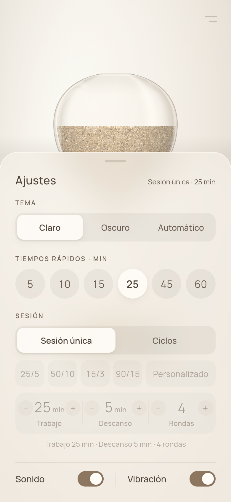
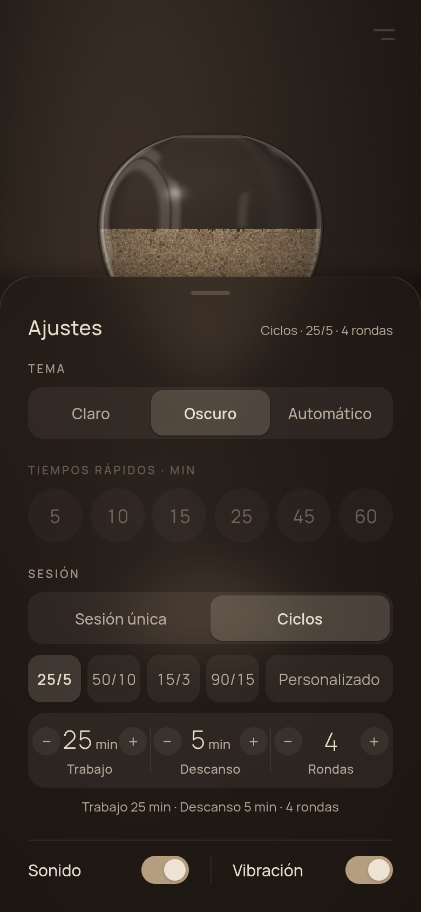
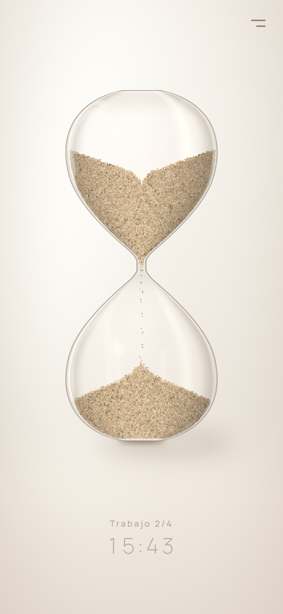
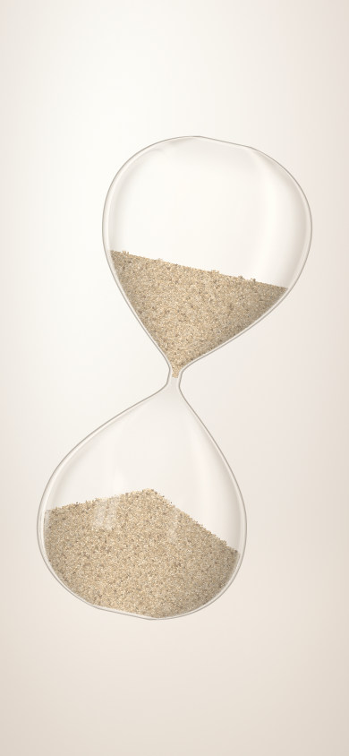

# Historial de cambios

Notas de cada entrega del **Reloj de Arena**: qué cambió, cómo actualizar desde la versión
anterior, memoria y rendimiento medidos y las pruebas manuales de cada una. Las versiones más
recientes van primero. La documentación general está en el [README](README.md) y el
funcionamiento interno en [docs/ARQUITECTURA.md](docs/ARQUITECTURA.md).

> Las entregas 1.0–1.4 se hicieron como carpetas comprimidas (`reloj-de-arena-fase1.x.zip`) y un
> APK de desarrollo. A partir de la publicación en GitHub basta con `git pull`; las
> instrucciones «Cómo actualizar» se conservan como referencia.

## 1.5.0 — Menú de ajustes, temas y ciclos trabajo/descanso (fase 3)

La **fase 3**: un menú discreto con vidrio esmerilado, tema claro/oscuro/automático, tiempos
rápidos, **ciclos trabajo/descanso** (adelanta la antigua fase 4), sonido y vibración
configurables y una entrada animada. **No hay cambios nativos:** sigue valiendo el APK de
desarrollo de la 1.3.

<p align="center">
  
  
  
  
</p>

### Cómo actualizar desde la 1.4

1. `git pull`.
2. **No hace falta `npm install`** (no cambia ninguna dependencia; las fuentes nuevas de Manrope
   ya venían en `@expo-google-fonts/manrope`).
3. **No hace falta APK nuevo**: el desenfoque es de Skia y la persistencia de AsyncStorage, que
   ya estaban en el APK de la 1.3.
4. `npm run mobile` y abre la app. Tus ajustes de la 1.4 se migran solos (tema, vibración y
   última duración se conservan).

### Novedades

| Qué                       | Cómo                                                                                                                                                                                                     | Dónde                                                    |
| ------------------------- | -------------------------------------------------------------------------------------------------------------------------------------------------------------------------------------------------------- | -------------------------------------------------------- |
| Botón de menú             | Dos rayas finas sin borde, arriba a la derecha (48×48 de zona táctil). Aparece con la entrada y se atenúa con el menú abierto.                                                                           | `components/menu/MenuButton.tsx`                         |
| Hoja de ajustes           | Sube desde abajo (Reanimated). Vidrio esmerilado real: `BackdropBlur` de Skia en el lienzo del reloj, con tinte, sombra y filo de luz. Se cierra arrastrando, tocando fuera, con «atrás» o Escape (web). | `components/menu/`                                       |
| Tema                      | Claro (`#EBE5DD`), Oscuro o Automático (sigue al sistema en vivo), con fundido de 520 ms. Se quitan los temas forzados de `TimerScreen.tsx` y `App.tsx`.                                                 | `theme/useAppTheme.ts`, `hourglass/useThemeCrossfade.ts` |
| Tiempos rápidos           | 5, 10, 15, 25, 45, 60 min. Deslizar sobre el reloj sigue funcionando igual.                                                                                                                              | `SettingsSheet.tsx`                                      |
| Ciclos                    | 25/5, 50/10, 15/3, 90/15 (4 rondas) y Personalizado (1–180 min, 1–12 rondas). Lógica pura en el core con tests, por marcas de tiempo.                                                                    | `core/src/session/`                                      |
| Cambio de fase            | El reloj se da la vuelta solo (950 ms), la arena vuelve a caer, suena `cambio.mp3`, vibra dos veces y el rótulo pasa a «Descanso 2/4». Al acabar: aviso de fin y vibración de éxito.                     | `useSandEngine.ts`, `TimerScreen.tsx`                    |
| Voltear el móvil (ciclos) | Reinicia la fase en curso.                                                                                                                                                                               | `core/src/session/session.ts` (`flipSession`)            |
| Sonido y vibración        | Interruptores en el menú (el ajuste `haptics` ya existía; `sound` es nuevo).                                                                                                                             | `sound/useCueSound.ts`, `haptics/`                       |
| Entrada animada           | Solo al arrancar en frío (~1,25 s): el reloj, algo más grande, gira 360° y se coloca; el tiempo y el menú aparecen después. Con «reducir movimiento», solo un fundido.                                   | `intro/useIntro.ts`, `Hourglass.tsx` (`pose`)            |
| Ajustes guardados         | Versión 2 de los ajustes: `sound`, `sessionMode`, `cyclePreset`, `customCycle`. Migración automática desde la 1.                                                                                         | `core/src/settings/settings.ts`                          |
| Accesibilidad             | Roles y etiquetas en todo el menú, zonas táctiles ≥ 44 px, contraste comprobado en los dos temas, anuncios de fase.                                                                                      | `components/menu/controls.tsx`, `theme/theme.ts`         |
| Reloj acelerado (dev)     | `?velocidad=60` en la URL de la web (solo desarrollo) para probar ciclos en segundos.                                                                                                                    | `dev/devClock.ts`                                        |

### Decisiones tomadas (se pueden cambiar)

- **Sin descanso después de la última ronda** (25/5 × 4 = T D T D T D T). Constante
  `FINAL_BREAK` en `core/src/session/cycles.ts`.
- **Cambiar el plan desde el menú reinicia la sesión** (vuelve a «lista para empezar»), también
  si estaba en marcha.
- Tocar un tiempo rápido pasa a **Sesión única**; tocar un preajuste o un stepper pasa a
  **Ciclos**. Tocar un stepper con un preajuste elegido pasa a **Personalizado** copiando sus
  valores. En ciclos, deslizar sobre el reloj cambia los minutos de **trabajo** (y pasa a
  Personalizado).
- Los steppers de minutos usan los mismos escalones que deslizar (1–10 de 1 en 1, 15–60 de 5
  en 5, 75–180 de 15 en 15).
- El botón del menú es un poco más oscuro que el tiempo para llegar a 3:1 de contraste; el
  tiempo y el rótulo de fase siguen siendo muy suaves a propósito.
- Voltear el móvil con el menú abierto cierra el menú.

### Pruebas

- **Core:** 140 tests en 16 archivos (nuevos: `cycles.test.ts`, `session.test.ts`; ampliado
  `settings.test.ts` con la migración). `npm run check` pasa entero.
- **Web, de extremo a extremo con Playwright** (Chromium sin GPU, 390×844): abrir el menú con
  el botón; cerrarlo tocando fuera, arrastrando hacia abajo, con el asa y con Escape; un
  arrastre corto no lo cierra; cada control (tema, chip de 25 min, preajuste 50/10,
  Personalizado, los tres steppers, sonido, vibración); persistencia tras recargar; deslizar y
  tocar el reloj después de usar el menú; un ciclo 1/1 × 2 a velocidad ×20 pasando por
  Trabajo 1/2 → Descanso 1/2 → Trabajo 2/2 → fin; la entrada (fotogramas), también con
  «reducir movimiento»; los dos temas; sin errores en la consola.
- **Errores encontrados y corregidos al probar:** la hoja no terminaba de cerrarse (un efecto
  cortaba la animación de salida y el velo se quedaba invisible encima, robando el primer
  gesto); el segmento del tema dejaba pegado su fondo en la web; «Personalizado» se cortaba; en
  el giro de la entrada el reloj no cabía a lo ancho; la opacidad de un `<Picture>` necesita una
  capa en Skia.

### Memoria y rendimiento (web, Chromium sin GPU)

| Momento                                                    | Memoria WASM (CanvasKit) | JS heap | FPS |
| ---------------------------------------------------------- | ------------------------ | ------- | --- |
| En marcha, antes de usar el menú                           | 134 MB                   | 30,8 MB | —   |
| Tras 24 aperturas del menú con cambio de tema (≈75 s, ×30) | 134 MB                   | 33,3 MB | ~40 |

La memoria WASM no se mueve (la foto del fundido de tema se libera) y el JS heap se estabiliza
(+0,2 MB en las últimas 6 vueltas). Los FPS son por software; en el móvil va por GPU.

### Pendiente de probar en Android

Arrastre de la hoja con el dedo, «atrás», el desenfoque por GPU, el sonido y la doble
vibración del cambio de fase, y que la entrada no se repita al volver de segundo plano.

## 1.4 — Pulido de realismo (y retoques 1.3.1)

Retoques visuales tras probar la 1.3 en un móvil real (lo que llamamos **1.3.1**) y el **pulido de
realismo** de la arena y el vidrio. **Todo es JavaScript/shaders: no hay cambios nativos**.

### Cómo actualizar desde la 1.3

1. Descomprime `reloj-de-arena-fase1.4.zip` y **copia su contenido encima de tu carpeta**
   `reloj-de-arena`, aceptando **reemplazar** los archivos.
2. **No hace falta `npm install`** (no cambia ninguna dependencia).
3. **No hace falta APK nuevo**: sigue valiendo `reloj-de-arena-dev-1.3.apk`, que ya tienes
   instalado (el APK de desarrollo carga el JavaScript desde tu PC).
4. Arranca como siempre: `npm run mobile` y abre la app. Si ves lo de antes, cierra la app
   del todo y vuelve a abrirla (o pulsa `r` en la terminal de Expo para recargar).

### 1.3.1 · Retoques visuales

| Qué                          | Antes                                                       | Ahora                                                                                                                                                                               | Dónde                                                   |
| ---------------------------- | ----------------------------------------------------------- | ----------------------------------------------------------------------------------------------------------------------------------------------------------------------------------- | ------------------------------------------------------- |
| Altura del tiempo (abajo)    | a 34 px del borde seguro, alto de línea automático (≈41 px) | a 34 + 40 = **74 px** (`TIME_BOTTOM`): su borde inferior queda donde antes estaba el superior. Alto de línea fijo `TIME_LINE_HEIGHT = 40` para que mida igual en Android, iOS y web | `screens/TimerScreen.tsx`, `components/TimeDisplay.tsx` |
| Tiempo con el móvil volteado | usaba el margen seguro de abajo                             | usa el de **arriba** (la capa está girada 180°, así que su «abajo» es la parte de la muesca)                                                                                        | `screens/TimerScreen.tsx`                               |
| Rótulo «Pausa»               | 26 px, color del tiempo, sin sombra                         | **38 px** (misma tipografía), color propio `theme.text.pause` y **halo suave** (`textShadow` de 18 px sin desplazamiento, `theme.text.pauseGlow`)                                   | `components/PauseLabel.tsx`, `theme/theme.ts`           |
| Colores de «Pausa»           | claro `#B3A698` · oscuro `#544A41`                          | claro **`#7D6E60`** con halo crema `rgba(250,246,240,0.95)` · oscuro **`#CDBFAD`** con halo oscuro `rgba(12,10,8,0.9)`                                                              | `theme/theme.ts`                                        |

### Pulido de realismo

| Qué                  | Cómo                                                                                                                                                                                                                                                                                                                                          | Dónde                                                        |
| -------------------- | --------------------------------------------------------------------------------------------------------------------------------------------------------------------------------------------------------------------------------------------------------------------------------------------------------------------------------------------- | ------------------------------------------------------------ |
| Tonos de grano       | Cada grano ya tenía su tono (1..255) fijado al crearse y que viaja con él. La tabla de colores ahora separa algo más los tonos (`CONTRAST` 0.6 → 0.75): varios matices de arena, estables, sin parpadeo.                                                                                                                                      | `hourglass/sandPainter.ts` (`buildPaletteLut`)               |
| Destellos de cuarzo  | Un ~5 % de los tonos (`SPARKLE_RATIO`) se marca con alfa 254 en la imagen de la rejilla (tabla `buildSparkleAlpha`, calculada una vez). El shader da a esos granos una «cara» con orientación propia: brillan cuando la luz, que se mueve al inclinar, se alinea con ella. Con el móvil quieto no cambian. Cero objetos nuevos por fotograma. | `hourglass/sandPainter.ts`, `hourglass/shaders/sand.ts`      |
| Vidrio más grueso    | Función `glassThickness(u)`: el vidrio es más grueso en los **extremos** y en el **cuello**. Ahí absorbe más (más teñido y oscuro), el canto se ve como una banda con un filo claro por dentro y un borde marrón muy tenue. El contorno pasa de 0.9 a 1.1 px y el brillo interior de 0.8 a 1.0 px.                                            | `hourglass/shaders/common.ts`, `glass.ts`, `staticLayers.ts` |
| Reflejos irregulares | Una ondulación suave (`glassWave`, dos senos: barata) tuerce un poco las ventanas reflejadas y varía su intensidad a lo largo del bulbo: ya no son rectángulos perfectos.                                                                                                                                                                     | `hourglass/shaders/glass.ts`                                 |
| Refracción           | Lo que se ve a través de los bulbos (el fondo) se ve un **3 % ampliado** (efecto lente) y ligeramente ondulado, y se desvía más donde el vidrio es grueso.                                                                                                                                                                                    | `hourglass/shaders/glass.ts`                                 |
| Vibración al voltear | Ya existía (impacto medio al completar el volteo, desde la 1.3): no se añade otra.                                                                                                                                                                                                                                                            | —                                                            |

Todo respeta **reducir movimiento** (los destellos y los reflejos dependen de la inclinación,
que en ese modo ya va más suavizada) y los dos temas.

### Memoria y rendimiento (Chromium headless, 390×844, DPR 1, ~25 s con el chorro activo)

| Momento                        | WASM (CanvasKit) | JS heap | FPS |
| ------------------------------ | ---------------- | ------- | --- |
| Al abrir                       | 128.0 MB         | 24.2 MB | —   |
| En marcha                      | 128.0 MB         | 24.9 MB | ~52 |
| Inclinado                      | —                | —       | ~50 |
| Tras pausa, reanudar y voltear | 128.0 MB         | 25.4 MB | ~39 |

La memoria **no crece** (igual que en la 1.3). Los FPS son de un navegador **sin GPU** (todo
por software); con la 1.3 en la misma máquina salían ~54 / ~53 / ~37, así que el coste extra
del pulido está dentro del ruido de la medida. En el móvil, con GPU, los shaders nuevos son
insignificantes. 0 errores en la consola.

### Capturas nuevas (`docs/capturas/`)

- `12-hora-reposo-claro.png`, `12-hora-reposo-oscuro.png`, `12-hora-en-marcha-claro.png`,
  `12-hora-en-marcha-oscuro.png`: el tiempo más arriba (1.3.1).
- `12-pausa-claro.png`, `12-pausa-oscuro.png`: el rótulo «Pausa» nuevo.
- `13-en-marcha-claro.png`, `13-en-marcha-oscuro.png`: pantalla completa con el pulido.
- `13-detalle-vidrio-claro.png`, `13-detalle-vidrio-oscuro.png`: de cerca (cuello, canto,
  tonos de los granos).
- `13-destellos-inclinado-claro.png`, `13-destellos-inclinado-oscuro.png`: inclinado, con
  algunos granos destellando.

### Pruebas manuales (~5 min, en el móvil)

1. El tiempo de abajo está más alto que antes (más o menos su propia altura) y no choca con
   nada. Volteando el móvil, el tiempo (arriba) no queda bajo la muesca/cámara.
2. Tumbando el móvil, «Pausa» se lee bien en el tema claro y en el oscuro, y sigue siendo
   discreto.
3. Mirando la arena de cerca se ven varios tonos de grano, y **no parpadean** con el móvil
   quieto.
4. Inclinando despacio, algunos granos sueltan un destello pequeño que aparece y desaparece.
5. El vidrio se ve algo más grueso arriba, abajo y en el cuello, y los reflejos no son
   rectángulos perfectos. Nada debería verse «de dibujo animado»: si algo te parece
   exagerado, es fácil de bajar (intensidades en `shaders/glass.ts` y `shaders/sand.ts`).
6. La fluidez es la de siempre (sin tirones) y lo de la 1.3 sigue igual (inclinar, pausa,
   volteo, vibración).

## 1.3 — Fase 2: inclinación, pausa de lado, volteo y vibración

Fase 2 completa: **el móvil es una ventana a un reloj de arena real**, más **vibración**.
Hay dos dependencias **nativas** nuevas (`expo-sensors` y `expo-haptics`), así que esta vez
**sí hace falta `npm install` y el APK nuevo** (`reloj-de-arena-dev-1.3.apk`).

### Cómo actualizar desde la 1.2

1. Descomprime `reloj-de-arena-fase1.3.zip` y **copia su contenido encima de tu carpeta**
   `reloj-de-arena`, aceptando **reemplazar** los archivos (tu `node_modules` se queda).
2. En la raíz: `npm install` (instala `expo-sensors` y `expo-haptics`).
3. Instala el APK nuevo en el móvil: abre `reloj-de-arena-dev-1.3.apk` y acepta
   **Actualizar** (es la misma app, firmada con la misma clave). Si Android dijera «La app no
   se ha instalado» (conflicto de firma), desinstala antes la versión anterior de _Reloj de
   Arena_ y vuelve a instalar.
4. Arranca como siempre: `npm run mobile` en la raíz y abre la app en el móvil.

El APK nuevo sigue cargando el JavaScript desde tu PC. **No pide permisos nuevos**: el
acelerómetro no necesita permiso en Android y la vibración usa `VIBRATE` (permiso «normal»,
no se pregunta). `expo-sensors` traía el permiso de actividad física (podómetro), que no usamos:
está **bloqueado** en `app.json` (`blockedPermissions`).

### Qué ha cambiado

| Parte                  | Qué hace ahora                                                                                                                                                                                                                                         |
| ---------------------- | ------------------------------------------------------------------------------------------------------------------------------------------------------------------------------------------------------------------------------------------------------ |
| **Inclinación**        | El acelerómetro (`expo-sensors`, ~30 Hz, filtro paso bajo) da la gravedad. La arena «cae» hacia el suelo real: la superficie se queda casi horizontal, el montón se desliza y el chorro se curva un poco. Con el móvil plano, el reloj sigue «de pie». |
| **Avalanchas**         | Un grano quieto no resbala en cuanto puede: arranca con cierta probabilidad por paso (rozamiento estático, `staticFriction`). Al inclinar, la pendiente aguanta un instante y cae en pequeñas avalanchas hasta el ángulo de reposo (~30–34°).          |
| **Pausa de lado**      | Tumbar el móvil a ~90° (entra a 70°, sale por debajo de 55°, con un rebote de ~0,2 s) pausa: el reloj se desenfoca y aparece «Pausa», girado para leerse derecho. Al ponerlo de pie, sigue. Una pausa con el dedo no se reanuda sola.                  |
| **Voltear**            | Darle la vuelta (más de 150°, mantenido 0,3 s) es como voltear un reloj real: empieza **de cero** con la duración elegida y la arena que estaba abajo pasa a caer desde arriba. La pantalla gira 180° (el texto se lee derecho). Se puede repetir.     |
| **Luz y reflejos**     | Los reflejos del vidrio, el brillo de los granos y el fondo se desplazan un poco con la inclinación (paralaje).                                                                                                                                        |
| **Sombra**             | La sombra suave del reloj sobre la mesa se desplaza y se alarga un poco hacia el lado al que inclinas.                                                                                                                                                 |
| **Pantalla encendida** | Mientras corre la arena (ya estaba; se apaga sola al pausar o terminar).                                                                                                                                                                               |
| **Reducir movimiento** | Filtro más lento, luz y sombra que se mueven menos, desenfoque sin animación y chorro calmado.                                                                                                                                                         |
| **Vibración**          | Ver tabla de abajo (`expo-haptics`). En la web no vibra.                                                                                                                                                                                               |

| Momento                        | Vibración (`expo-haptics`)                                          |
| ------------------------------ | ------------------------------------------------------------------- |
| Empezar / reanudar             | `impactAsync(Medium)`                                               |
| Pausar (con el dedo o de lado) | `impactAsync(Heavy)` (más fuerte, para distinguirla)                |
| Voltear                        | `impactAsync(Medium)` (una sola vez)                                |
| Cada escalón al deslizar       | Android: `performAndroidHapticsAsync(Clock_Tick)`; iOS: `selection` |
| Fin del tiempo                 | `notificationAsync(Success)`, junto al sonido                       |

Los clics al deslizar son uno por escalón que cambia y nunca dos a menos de 30 ms
(`StepTicker`). Hay un ajuste nuevo `haptics` (por defecto activado, aún sin menú).

**Dónde está cada cosa:**

- Lógica pura y testeada (core): `physics/motion.ts` (filtro, gravedad de pantalla, escalones
  de 3° para la simulación, luz), `physics/orientation.ts` (máquina de estados de pausa y
  volteo con histéresis y rebote), `timer/haptics.ts`, `flip()` en `timer/engine.ts`,
  avalanchas y `rotateHalfTurn()` en `sim/sandSimulation.ts`.
- App: `src/motion/` (acelerómetro → `LiveMotion`; simulador de teclado para la web),
  `src/haptics/`, `components/PauseLabel.tsx`, y en `hourglass/` el `GlassPainter`
  (vidrio y sombra que se regraban baratos cuando cambia la luz) y `pictureSlot.ts`.
- La pantalla **no se re-renderiza** con cada muestra del sensor: el sensor escribe en un
  objeto que el bucle de animación lee en cada fotograma; React solo se entera de los eventos
  (pausa, volteo).

### Probar la inclinación en el navegador (sin móvil)

Con `npm run web` (modo desarrollo) — o en cualquier versión web añadiendo `?inclinar` a la
URL — puedes simular el acelerómetro con el teclado (haz clic antes en la página):

| Tecla           | Efecto                                               |
| --------------- | ---------------------------------------------------- |
| `←` / `→`       | Girar el móvil 5° a izquierda / derecha              |
| `Mayús` + `←/→` | Girar 30° (dos veces + una normal ≈ 65°; tres = 90°) |
| `↑` / `↓`       | Inclinarlo hacia atrás / delante (mueve la luz)      |
| `V`             | Voltear 180° de golpe                                |
| `0`             | Volver a «de pie»                                    |
| `Alt` + ratón   | Mover el ratón con Alt pulsado gira el móvil         |

Antes de la primera tecla no se simula nada: la web funciona exactamente igual que antes.

### Memoria y rendimiento medidos (Chromium headless, 390×844, ~25 s con el chorro activo)

| Momento                                | WASM (CanvasKit) | JS heap (tras GC) | FPS |
| -------------------------------------- | ---------------- | ----------------- | --- |
| Inicio (antes de empezar)              | 128,0 MB         | 24,2 MB           | —   |
| En marcha, de pie                      | —                | —                 | ~56 |
| Inclinado 25° (≈10 s)                  | 128,0 MB         | 25,1 MB           | ~54 |
| Tras pausar, reanudar y voltear (25 s) | 128,0 MB         | 25,3 MB           | ~40 |

WASM plano y 0 errores en consola. Los FPS son de Chrome **sin GPU** (lo dibuja la CPU): justo
después de voltear se mueve casi toda la arena a la vez y baja a ~40; en el móvil lo dibuja la
GPU. La simulación en sí cuesta ~0,2 ms por fotograma (Node).

### Capturas nuevas

- `docs/capturas/09-inclinado-claro.png` / `09-inclinado-oscuro.png`: inclinado 25° a la derecha
  (superficie casi horizontal, chorro curvado, sombra desplazada).
- `docs/capturas/10-pausa-tumbado-claro.png` / `10-pausa-tumbado-oscuro.png`: tumbado de lado →
  pausa con desenfoque y «Pausa».
- `docs/capturas/11-volteado-oscuro.png`: recién volteado (vista de la pantalla; en la mano se ve
  al derecho): la arena de abajo cae ahora desde arriba y la cuenta empieza de cero.

### Pruebas manuales (~10 min, en el móvil)

1. **Inclinar**: con el reloj en reposo, inclina despacio a izquierda y derecha. La superficie
   de la arena debe quedarse casi horizontal, deslizándose en pequeñas avalanchas (no de golpe),
   y la luz de los reflejos y la sombra deben moverse un poco.
2. **Pausa de lado**: pon 5 min, empieza y tumba el móvil de lado (como una foto apaisada).
   Debe vibrar fuerte, desenfocarse y salir «Pausa» legible. Las inclinaciones normales (30–50°)
   **no** deben pausar.
3. **Reanudar**: vuelve a ponerlo de pie → vibra (medio) y la cuenta sigue donde iba.
4. **Voltear**: con el tiempo corriendo, dale la vuelta del todo. Debe vibrar una vez, la cuenta
   volver a la duración elegida y la arena que estaba abajo caer desde arriba. Vuelve a
   voltearlo: lo mismo otra vez.
5. **Clics al deslizar**: con el reloj parado, desliza arriba/abajo: un «clic» por cada minuto
   (o escalón), como una rueda dentada; rápido no debe sonar a zumbido continuo.
6. **Empezar / pausar con el dedo**: toque para empezar (vibración media) y otro para pausar
   (más fuerte, distinta).
7. **Fin**: pon 1 minuto y déjalo acabar: sonido y vibración suave de aviso, una sola vez.
8. **Pantalla encendida**: con 5 min en marcha la pantalla no debe apagarse; en pausa sí se
   apaga cuando toque según tus ajustes.

## 1.2 — Chorro de granos, cuello y montón más realistas

Más realismo visual en el chorro, el cuello y el montón. **Solo cambia JavaScript/TypeScript:**
no hay dependencias nuevas (no hace falta `npm install` si ya tenías la 1.1 instalada) y **no
hace falta un APK nuevo**: el `reloj-de-arena-dev.apk` de la 1.1 sirve tal cual.

### Cómo actualizar desde la 1.1

1. Descomprime `reloj-de-arena-fase1.2.zip` en una carpeta nueva (o copia encima de la tuya
   `packages/`, `apps/mobile/src/`, `docs/` y `README.md`; tu `node_modules` sirve).
2. Si es una carpeta nueva: `npm install` en la raíz (las mismas versiones que la 1.1).
3. Arranca como siempre:
   - desde la **raíz**: `npm run mobile`
   - o dentro de **`apps\mobile`**: `npx expo start`
4. Abre la app del APK de desarrollo (o pulsa `r` en la terminal para recargar).

### Qué ha cambiado

| Parte                   | Antes (1.1)                     | Ahora (1.2)                                                                                                                                                                                                                               |
| ----------------------- | ------------------------------- | ----------------------------------------------------------------------------------------------------------------------------------------------------------------------------------------------------------------------------------------- |
| **Chorro**              | Una línea dibujada              | Granos sueltos (`StreamParticles`, en `packages/core/src/sim/stream.ts`) que **aceleran con la gravedad**: más juntos junto al cuello y más separados abajo. Ritmo irregular con huecos, ancho que tiembla y algún grano descarriado.     |
| **Final del chorro**    | Se apagaba de golpe             | Al quedar poca arena arriba el chorro se **adelgaza** y termina con los **últimos granos** cayendo.                                                                                                                                       |
| **Cuello / embudo**     | Corte recto                     | Borde irregular y suave: los granos de las últimas filas «hierven» (alfa parcial que cambia) y hay un pequeño remolino de granos sueltos que entran al cuello.                                                                            |
| **Impacto**             | El grano aparecía en la cima    | Pico cónico: algunos granos **salpican** un poco y otros **ruedan** por la ladera antes de pararse.                                                                                                                                       |
| **Montón**              | (error oculto) torre de 1 grano | Corregido un error de la 1.1: con pocos FPS caían varios granos por fotograma en la misma celda y crecía una «torre» de un grano de ancho que parecía un chorro sólido (la línea de la 1.1 lo tapaba). Ahora el grano rueda al aterrizar. |
| **Movimiento reducido** | —                               | Con «Reducir movimiento» activado: chorro más fino y tranquilo, sin remolino ni salpicaduras y sin parpadeo en el cuello.                                                                                                                 |

Detalles técnicos:

- **Memoria fija**: las partículas viven en arrays tipados preasignados (`Float32Array`/`Uint8Array`,
  capacidad 360) y se eliminan con _swap-remove_. No se crea **ningún objeto Skia nuevo por
  fotograma** para ellas: se dibujan con dos `Paint` persistentes y un `Float32Array` de color
  reutilizado.
- **Determinista**: toda la aleatoriedad usa el generador con semilla del proyecto (misma semilla
  → mismos granos), probado en `packages/core/test/stream.test.ts`.
- **Sin NaN**: entradas raras (dt negativo/NaN/enorme, gravedad cero) no rompen nada (también
  probado).
- Nuevos tests: `stream.test.ts` (8) y `landing.test.ts` (la regresión de la «torre»). En total
  **85 tests**, todos en verde, igual que typecheck, lint y formato.

### Memoria medida (Chromium headless, sesión corta de ~25 s con el chorro activo)

| Momento                   | WASM (CanvasKit) | JS heap (tras GC) |
| ------------------------- | ---------------- | ----------------- |
| Inicio (antes de empezar) | 128,0 MB         | 23,6 MB           |
| 12 s en marcha            | 128,0 MB         | 24,4 MB           |
| 25 s en marcha            | 128,0 MB         | 24,6 MB           |

WASM plano (igual que la 1.1), 0 errores en consola, ~57 FPS.

### Capturas de cerca

- `docs/capturas/05-chorro.png`: el chorro de granos sueltos.
- `docs/capturas/06-cuello.png`: el borde irregular del embudo.
- `docs/capturas/08-pico.png`: el pico del montón con granos en la ladera.
- `docs/capturas/07-fondos-claros.png`: comparación de fondos claros (ver abajo).

### Fondo claro: valor actual y cómo cambiarlo

Desde la 1.2.1 el fondo claro es la **variante D (`#EBE5DD`, más claro)**, elegida por Sebastián.
Vive en **un solo token**, en `apps/mobile/src/theme/theme.ts`:

```ts
export const LIGHT_BACKGROUND = '#EBE5DD';
```

De ese token salen, con desplazamientos fijos, los demás tonos del fondo. Con la variante A
(`#E2D9CE`, la de la 1.0/1.1) eran estos:

| Uso                                         | Valor     |
| ------------------------------------------- | --------- |
| Color sólido (vista raíz / barra de estado) | `#E2D9CE` |
| Degradado arriba                            | `#ECE5DC` |
| Degradado abajo                             | `#D6CBBE` |
| Halo detrás del reloj                       | `#F8F3EC` |
| Viñeta de las esquinas                      | `#BFB1A2` |

Aparte, `apps/mobile/app.json` tiene `backgroundColor: #E6DED4` (solo la pantalla de carga y el
fondo del icono adaptativo de Android; no afecta a la app ya abierta).

En `docs/capturas/07-fondos-claros.png` tienes el reloj en reposo sobre 4 variantes:

| Variante | Hex       | Descripción             |
| -------- | --------- | ----------------------- |
| A        | `#E2D9CE` | el de la 1.0/1.1        |
| B        | `#E7D8C3` | más cálido              |
| C        | `#DDDAD5` | más neutro / gris       |
| D        | `#EBE5DD` | más claro (**elegido**) |

Para elegir otra, cambia solo el valor de `LIGHT_BACKGROUND` y guarda (se recarga solo).

### Pruebas manuales (~10 min)

1. Arranca (`npm run mobile` en la raíz o `npx expo start` en `apps\mobile`) y abre en el móvil
   y/o en el navegador (`w`).
2. Pon **1 minuto** y empieza. Mira el chorro de cerca: ¿se ven granos sueltos, más juntos arriba
   y más separados abajo, con huecos?
3. Mira el **cuello**: ¿el borde se ve irregular y «vivo» en vez de un corte recto?
4. Mira el **pico** del montón: ¿algún grano salta o rueda por la ladera?
5. Deja que termine: el chorro debe **adelgazarse y acabar con los últimos granos**, y suena el
   aviso una sola vez.
6. Inclina el móvil o dale la vuelta (gesto): el chorro sigue al cuello sin granos «perdidos».
7. Activa **Reducir movimiento** (Android: Ajustes → Accesibilidad → Quitar animaciones) y
   repite el paso 2: debe verse más tranquilo.
8. Prueba un temporizador **largo** (p. ej. 30 min) un rato: el chorro es más fino.
9. Comparar las variantes de `07-fondos-claros.png` (en la 1.2.1 se eligió la D).

## 1.1 — Estabilidad en web, sonido y APK de desarrollo

### Errores de la web corregidos (y su causa real)

| Síntoma                                                                                                                               | Causa                                                                                                                                                                                                                                                                                                                              | Arreglo                                                                                                                                                                                                                                                                |
| ------------------------------------------------------------------------------------------------------------------------------------- | ---------------------------------------------------------------------------------------------------------------------------------------------------------------------------------------------------------------------------------------------------------------------------------------------------------------------------------- | ---------------------------------------------------------------------------------------------------------------------------------------------------------------------------------------------------------------------------------------------------------------------- |
| Pantalla en blanco, `RuntimeError: unreachable`, `memory access out of bounds`, `Aborted()` (sobre todo con la arena cerca de acabar) | **Fuga de memoria WASM**: en cada fotograma se creaban un `Paint`, un shader de imagen y un shader de arena que nunca se liberaban, y como el shader guardaba la imagen de la rejilla (~80 KB), CanvasKit crecía ~4 MB/s hasta agotar su memoria. Por eso fallaba «solo con el tiempo corriendo» y tras un rato (cerca del final). | Cero objetos Skia nuevos por fotograma salvo los inevitables (imagen de la rejilla, sus 2 shaders y el picture), que se liberan nada más usarse. `Paint`, `PictureRecorder`, rectángulos, colores y buffers de uniforms se crean una vez y se reutilizan.              |
| La arena no se ve mientras corre; aparece al deslizar                                                                                 | Al **recrearse la simulación** con el tiempo corriendo (Fast Refresh o **cambio de tamaño de la ventana**, p. ej. al abrir la consola), la rejilla nueva empezaba vacía y el controlador de flujo «recolocaba» 0 granos. Solo el gesto (que vuelve a reposo) la rellenaba.                                                         | El bucle detecta una simulación nueva y la rellena según el tiempo restante; además `syncSandToTarget` usa la cantidad nominal de arena si la rejilla está vacía (con test).                                                                                           |
| Errores tras un hot reload (`null function` en `PathBuilder.lineTo`)                                                                  | Objetos Skia a nivel de módulo (shaders, picture vacío) que sobrevivían al Fast Refresh, y objetos liberados mientras el lienzo aún los dibujaba.                                                                                                                                                                                  | Nada de Skia a nivel de módulo: cada `<Hourglass>` crea sus shaders y los libera al desmontarse. Todo se libera **con retraso** (`disposal.ts`), cuando el lienzo ya no lo usa. Los paths validan que no haya NaN/Infinity antes de tocar Skia.                        |
| Una vez roto, error en bucle cada fotograma                                                                                           | Nada capturaba los errores del bucle de animación (corre fuera del render de React).                                                                                                                                                                                                                                               | **Error boundary** (`HourglassBoundary`): el bucle se para al primer error y el lienzo se remonta con esperas crecientes (0,3 s, 0,6 s…). Si CanvasKit ha muerto (eso no se arregla remontando), guarda la cuenta en `sessionStorage` y recarga la página **una vez**. |

Con **reducir movimiento** activado la arena sigue reflejando el progreso (sigue cayendo grano a
grano); solo se dibuja estático el chorro. El aviso «Reduced motion setting is enabled» de
Reanimated es informativo.

### Cómo actualizar desde la 1.0

1. Descomprime `reloj-de-arena-fase1.1.zip` en una carpeta **nueva** (no encima de la anterior;
   así no se mezclan archivos borrados o movidos).
2. En esa carpeta: `npm install` (hay dependencias nuevas: `expo-audio` y `expo-dev-client`).
3. `npm run web` para probar en el navegador, o `npm run mobile` + el APK para el móvil.
   Si algo raro persiste, arranca limpiando la caché: `cd apps/mobile` y `npx expo start -c`.

### Pruebas manuales (navegador; ~15 min)

Con la consola del navegador abierta (F12) en la pestaña _Console_:

1. **Varios tiempos:** elige 1 min, 2 min y 5 min deslizando. Empieza cada uno y **déjalo
   terminar** sin tocar nada: la arena debe verse y bajar todo el rato, y el reloj quedar en
   00:00 con «toca para volver a empezar».
2. **Sonido:** al llegar a 00:00 debe sonar el aviso **una vez**. Si pausas o reinicias
   (mantener pulsado) antes del final, **no** debe sonar.
3. **Consola / redimensionar:** con el tiempo corriendo, cierra y abre la consola y cambia el
   tamaño de la ventana varias veces: la arena debe seguir visible y en su sitio.
4. **Deslizar en marcha:** con el tiempo corriendo, desliza arriba/abajo (no debe cambiar la
   duración ni romper nada); pausa y desliza (vuelve a reposo con la nueva duración).
5. **Hot reload:** con el tiempo corriendo, guarda cualquier archivo (p. ej. añade un espacio en
   `TimeDisplay.tsx`): la arena debe seguir.
6. **Memoria (opcional):** en Chrome, _Más herramientas → Administrador de tareas_: la memoria
   de la pestaña debe mantenerse estable sesión tras sesión.
7. **Modo oscuro:** cambia el tema del sistema y repite una sesión corta.

**Si algo falla, conviene recoger:** (a) qué paso y qué ves (una captura ayuda), (b) **todo** el texto
rojo/amarillo de la consola del navegador (botón derecho → _Save as…_ o copiar), (c) las últimas
~30 líneas de la terminal donde corre `npm run web`, y (d) navegador y versión. Los avisos que
empiezan por `[reloj]` son del propio reloj y dicen qué ha decidido (remontar/recargar).

### Otras mejoras

- **Sonido al terminar** (`expo-audio`): se precarga una vez, se libera al desmontar y suena
  una vez solo si la cuenta llega a 0 sola. En web, los navegadores solo permiten audio
  después de una interacción del usuario; como para empezar hay que tocar el reloj, funciona.
  Si un navegador lo bloqueara, la app sigue igual (el fallo se ignora).
- **Borde de la arena más natural**: las esquinas de los escalones de la superficie se rellenan
  parcialmente con granos sueltos, y los microgranos tienen más desplazamiento aleatorio (menos
  aspecto de rejilla). La arena de arriba se hunde en **embudo** sobre el cuello.
- **Número de granos revisado**: ~6.000 granos simulados en un móvil de 390×844 dp (cada uno se
  dibuja como 4 microgranos ≈ 24.000 granos visibles). Toda la simulación ocupa < 200 KB.
  Con granos más grandes (2,6 dp) se ahorrarían ~1.600 granos pero la arena se ve gruesa; no
  compensa.

### Dependencias que cambian (haz `npm install` tras descomprimir)

- ➕ `expo-audio` (~58.0.10): sonido final.
- ➕ `expo-dev-client` (~58.0.14): APK de desarrollo.
- `app.json`: paquete Android `com.sebastianzaruha.relojdearena`, esquema `relojdearena` y
  plugin `expo-audio`.

### Verificación de la 1.1

Verificado en la entrega 1.1:

- ✅ `npm run typecheck`, `npm run lint`: sin errores.
- ✅ `npm test`: **76 tests** en 9 archivos, 100 % de líneas cubiertas en `core` (incluye casos
  extremos de final de cuenta: progreso 0, ~0,99, 1 y más allá; entradas NaN/Infinity; avisos;
  serialización; política de recuperación).
- ✅ `npx expo export --platform web` compila. APK de desarrollo de Android compilado
  localmente con Gradle (sin EAS ni cuentas de Expo).
- ✅ Web en Chromium sin interfaz, con el **servidor de desarrollo** (`expo start`) igual que tú:
  3 sesiones de 1 minuto seguidas hasta el final + redimensionados → la arena se ve y avanza
  sin tocar nada, **0 errores**, sonido final **exactamente 1 vez por sesión**, y memoria
  **plana** (ver tabla de abajo).
- ✅ **Fast Refresh**: 15 ediciones seguidas de `App.tsx`, `sandPainter.ts`, `useSandEngine.ts`,
  `Hourglass.tsx` y `TimerScreen.tsx` con el tiempo corriendo → 0 errores, la arena sigue
  visible, memoria WASM sin cambios.
- ✅ Error boundary con fallos inyectados: (a) fallos de dibujo puntuales → el lienzo se remonta
  en ~0,3 s y la cuenta sigue; (b) motor gráfico «muerto» → una única recarga y la cuenta
  continúa donde iba.

**Memoria medida en web** (Chromium, 390×844; memoria WASM = tamaño del heap de CanvasKit;
JS = `usedJSHeapSize` tras forzar la recolección de basura):

| Momento                       | Antes (1.0) WASM | Ahora (1.1) WASM | Ahora JS heap |
| ----------------------------- | ---------------- | ---------------- | ------------- |
| Antes de empezar              | 128 MB           | 128 MB           | 23,6 MB       |
| Sesión 1 terminada (1 min)    | 319 MB           | 128 MB           | 24,7 MB       |
| Sesión 2 terminada (+ resize) | 551 MB           | 128 MB           | 25,7 MB       |
| Sesión 3 terminada            | 839 MB           | 128 MB           | 26,1 MB       |

Antes crecía ~4 MB por segundo de arena en marcha hasta que CanvasKit abortaba; ahora es plana
(los 128 MB son la reserva inicial de CanvasKit; el JS heap oscila ±1 MB por el recolector).

**No verificado (sé honesto contigo mismo al probarlo):**

- ❌ El APK **no se ha probado en un Android real** (no hay móvil en el entorno de compilación).
  El rendimiento real (objetivo 60 fps en gama media) y los shaders en GPU móvil están sin
  medir. Si notas tirones, los primeros ajustes están en `useSandEngine.ts`
  (`STEPS_PER_FRAME`) y `layout.ts` (`TARGET_CELL_PX`, granos más grandes = menos celdas).
- ❌ El sonido se ha comprobado en web (se llama a `play()` una vez); no se ha escuchado en
  Android.
- ❌ TalkBack y «reducir movimiento» no se han probado con el sistema real.
- ℹ️ Si cierras la app del todo (no solo segundo plano), la cuenta en curso se pierde; solo se
  recuerda la última duración. (En web sí se conserva si la app tiene que recargarse por un
  fallo gráfico.)
- ℹ️ Icono y splash son los de la plantilla de Expo.
- ℹ️ `npm audit` avisa de vulnerabilidades en dependencias **de desarrollo** de las herramientas de
  Expo (no llegan a la app). No uses `npm audit fix --force`: rompería las versiones del SDK.

## 1.0 — Fase 1

Primera versión: temporizador con forma de reloj de arena (deslizar para elegir 1 min – 3 h,
tocar para empezar/pausar, mantener pulsado para reiniciar), simulación granular de la arena,
vidrio 2.5D con shaders de Skia, temas claro y oscuro, versión web con CanvasKit y núcleo de
lógica pura con tests (`@reloj/core`).
